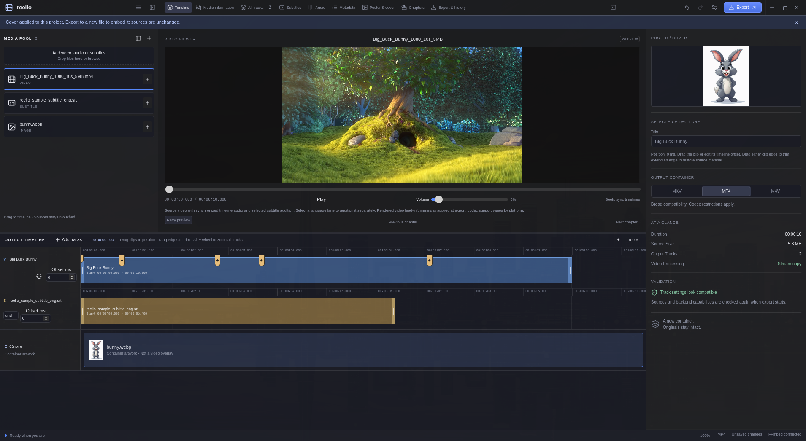

# Reelio

A local-first desktop media container editor built with Rust, Tauri 2, React, TypeScript, SQLite, FFmpeg, and FFprobe.

**Status: working 0.2 developer preview, not a production-ready implementation of the entire product specification.** The import/edit/plan/remux/verify workflow is implemented. Catalog APIs, advanced editing, and release qualification remain open; see [implementation status](docs/implementation-status.md).



## Downloads

[Reelio 0.2.0-6](https://github.com/vcsoc/reelio/releases/tag/v0.2.0-6) provides a Linux x86_64 AppImage, an Arch/Omarchy package, a Windows x64 installer and SHA256SUMS. The AppImage bundles GStreamer; FFmpeg/FFprobe remain external. Packaged startup checks pass on Ubuntu 22.04 and Arch; Windows PE/version/build checks pass, but interactive Windows qualification, broader playback testing and signing remain open. Existing cross-platform CI failures are disclosed in the [release notes](docs/releases/0.2.0-6.md). See [packaging](docs/packaging.md) for password-free per-user installation, dependencies and FUSE-free execution.

## Run

Install Node.js 22+, Rust stable, and a maintained FFmpeg distribution with FFprobe on your PATH. FFmpeg is **not bundled**. The Arch/Omarchy package installs required media, playback and HTTPS components through pacman; supported Linux installations also offer an authorized in-app component repair. For source builds on Linux, install the [Tauri prerequisites](https://v2.tauri.app/start/prerequisites/) (GTK 3, WebKitGTK 4.1, librsvg and build tools). Linux AV1 playback also requires a supported GStreamer AV1 decoder; the Arch package installs `gst-plugin-dav1d`, and Debian/Ubuntu repair includes the bad-plugin decoder package. Windows requires MSVC build tools and WebView2; macOS requires Xcode command-line tools.

```sh
cd apps/desktop
npm ci
npm run tauri dev
```

If using mise, `mise install` selects the repository's Rust toolchain. Preferences supports absolute FFmpeg/FFprobe paths; restart to apply changes. The browser-only `npm run dev` renders the UI but intentionally cannot access media.

## Appearance

Reelio keeps Pigeon's charcoal-and-blue styling in a DaVinci-inspired editing layout: upper-left media pool/dropbox, large upper-center source viewer, stacked timelines below, and a right inspector topped by the project's poster/cover (or Select a cover placeholder). Project Tools now lives across the top toolbar rather than inside the media sidebar. Its horizontal tabs open track settings, metadata, chapters and export/history inside the right inspector; compact widths use labeled-by-tooltip icons. **Poster & cover** opens its browser and image editor in the large lower workspace in place of the timelines; select **Timeline** to return to the lanes. The compact cover preview remains in the inspector. The layout icon in the media-pool header switches the left panel between upper-left and full-height layouts. Toolbar icons independently collapse or expand either sidebar and remain accessible when the panels are hidden. Layout, visibility and panel widths are remembered locally without modifying the project. The inspector's left edge remains resizable. The borderless viewer project-title field has a high-contrast blue/white text-selection highlight in both themes, with a visible caret and keyboard focus. The media pool uses readable file rows with separate add-to-timeline buttons. New profiles default to dark mode; existing light/dark/system preferences are preserved. See [UI styling](docs/ui-styling.md) for the design reference and regression coverage.

The desktop toolbar is the window's actual top bar: there is no separate operating-system title strip above it. Drag unused toolbar space or the Reelio brand to move the window; double-click to maximize/restore. Omarchy/Hyprland uses the compositor's window management without duplicate window buttons. Other Linux desktops use Linux-style controls on the right; macOS uses red/yellow/green controls at the far left. Windows retains its right-side controls. Toolbar buttons, menus and dialogs do not initiate dragging. Quit Reelio in the hamburger menu, Ctrl/Cmd+W and operating-system close requests share one confirmation flow: unsaved project changes require approval, and an unsaved subtitle draft can be kept for recovery on confirmed quit without redirecting to Studio. Native export, component-repair, update-download and model-operation protections remain authoritative. Save/result notifications appear as floating custom toasts and auto-hide after five seconds (errors after eight); hovering or focusing pauses dismissal. At narrow sizes the tools wrap beneath the window controls; browser preview keeps the browser's own window chrome.

## Project Actions

Open the **Project menu** hamburger immediately before the left-sidebar toggle for **New project**, **Open project**, **Open media** and **Save project**. **Add tracks** is directly in the **Output Timeline** header and opens the same media chooser, disabled while an operation is busy. Existing keyboard shortcuts remain available: New is Ctrl/Cmd+N and Open project is Ctrl/Cmd+Shift+O. New creates a clean untitled project; Open loads a validated `.reelio` file and its referenced local sources automatically, without a second authorization prompt. Only open projects you trust; individual-file scope and source/export validation remain in place. Both check for unsaved changes before replacing the current project. Canceling or failing to open a file keeps the current project intact. **About Reelio** in the same menu shows the full compiled version/build (for example, `0.2.0-1`), **Developed by Chris Visser**, and [github.com/vcsoc/reelio](https://github.com/vcsoc/reelio). The desktop link opens the system browser; it does not replace the editor or grant an arbitrary-URL launch capability. Browser preview identifies itself rather than pretending to be an installed build. **Save project** (Ctrl/Cmd+S) also works before media is added. **Open media** remains Ctrl/Cmd+O and adds media to the current project.

**Check for updates** manually checks stable GitHub releases using numeric versions and platform-matching assets. Verified downloads require exact size/SHA-256 and never overwrite or install automatically; failures and no published releases are not reported as up to date. See [updates](docs/updates.md) for limits, unsigned-package policy and publishing.

## Working Workflow

1. Open media, add tracks from additional files, import a folder **non-recursively** (up to 256 entries), or drop files onto the native window.
2. Inspect source properties and select the streams to include. Rename, reorder, assign three-letter languages, set defaults, and edit audio/subtitle dispositions.
3. Edit mapped metadata and chapters. Undo/redo supports project edits. Native `.reelio` project files store references, never video payloads.
4. The **Export & history** panel contains selected-lane title/language/output-role controls and MKV/MP4/M4V container buttons in place of the former Output profile dropdown. Container selection is available before media is imported. New projects default to **MP4**; saved projects retain their explicit MKV/MP4/M4V selection. Choose another format if needed. Review compatibility and conversion warnings. For MP4/M4V, Reelio automatically selects the first included video/audio/subtitle track of each kind when no default is chosen. Explicit selections are preserved. Automatic choices are shown as Auto in the track list and resolved explicitly for both muxing and verification, so missing default flags no longer block export.
5. Validate sources and review the plan. Subtitle conversion and timeline rendering require explicit authorization. Choose a **new** output destination.
6. Follow real FFmpeg progress, cancel if needed, and inspect persisted export history.

Sources are never written. A temporary file in the destination directory is probed and checked before non-overwriting finalization. Existing destinations are refused, including a destination created by another process during export. A verification failure removes the temporary output rather than publishing an unverified file.

## Interface Zoom

Use **Ctrl/Cmd+plus** (or Ctrl/Cmd+=) and **Ctrl/Cmd+minus** to zoom the whole interface in 10% steps between 50% and 200%. **Ctrl/Cmd+0** or the status-bar zoom percentage resets to 100%. The preference is remembered separately from project data. Desktop uses native WebView page zoom; browser preview uses an approximate CSS fallback. Alt+wheel still controls timeline time-scale zoom independently.

## Timeline Editing

Every audio/subtitle stream has an independent lane. Drag clips horizontally to change their saved output position; positive offsets delay, negative offsets trim the beginning. Arrow keys move clips by 100 ms (Shift: one second; Alt: 10 ms). Precise offsets are also editable in milliseconds. Hold **Alt and scroll the mouse wheel** to zoom all timelines together. When the mouse is over a lane's time area, its exact time stays anchored under the cursor; when the mouse is elsewhere in the app, zoom keeps the playback marker visible (bringing an offscreen marker back into view). The toolbar's **- / +** buttons use the same cursor/playhead rule, including keyboard activation. All lanes share horizontal scrolling and zoom, so equal times stay aligned. Rapid wheel events accumulate against the latest shared view rather than stale painted scroll positions. At the beginning/end or when the entire timeline fits, scrolling is bounded by the available timeline. The percentage button resets to the full shared view. Zoom is session-only UI state. The timeline's fit extent uses retained clip ends, including excluded clips, not the hours-long original duration of an already-trimmed subtitle. Minimum-width clips snap against the edge actually drawn on screen. Fractional-display WebKit scroll rounding is corrected without feeding programmatic scroll events back through the synchronized lanes.

Drag the narrow handles at either end of a video, audio or text-subtitle clip to shorten it or restore previously trimmed material. Edges cannot extend beyond the original source or cross each other. While dragging an audio or text-subtitle right edge, coming within **8 screen pixels** of the included video's retained timeline end snaps to that exact millisecond, even when it is not on the normal 10 ms drag grid. The trim handle highlights blue while aligned; moving outside that distance releases the snap. This uses the same offset-aware/latest-included-video end as Clip to video, never extends beyond the source or crosses the left trim, and remains one undoable edit. Escape/cancel discards it; keyboard edge adjustment remains unsnapped for precise overrides. The body still moves the whole clip without slipping its content. Each completed drag is one undo step; canceled drags are discarded. Focus a handle for arrow-key adjustment (100 ms; Shift: one second; Alt: 10 ms), Home/End for its source limits, or double-click to restore that boundary. **Reset clip trims** in the selected-lane inspector restores both boundaries. Trims are saved with the project and apply to export, not just the drawing. Image-subtitle handles are disabled because their timing is not supported.

Each video lane has a **target/crosshair icon** beside its offset controls. Click it to choose the main/source timing reference; blue means selected. It controls **Clip to video**, **Ctrl+Alt-click** fitting and magnetic end snapping, using that specific clip's retained end and offset, even if the reference is excluded from export. Choosing a reference also previews its source, is undoable and is saved by stable track ID. It does not crop other clips immediately or change inclusion. Click the active icon again to return to automatic reference selection. Removing the reference clears it in the same undo step; image/cover resources cannot be references. An explicit reference also lets other video clips use fitting/snapping; normal export rendering consent still applies. Without an explicit reference, existing latest-included-video behavior remains. Automatic export-window policy still uses included videos, not this editing-only preference. Projects with the optional reference field require this build or newer; clearing it omits the field on save.

Right-click a timeline clip (or focus it and press Shift+F10) to **Include/Exclude** it or **Remove** its lane. Remove keeps the source in the media pool; Undo restores the same track, and the pool's + button can add a removed stream again. For audio, text subtitles or another video clip, choose **Clip to video**, or hold **Ctrl+Alt and click the clip body**, to shorten its right edge to the included video's retained timeline end. With no explicit main reference and multiple included videos, the latest end is used, matching export policy. Clip offsets and left trims stay unchanged; this is one undoable, saved project edit, unlike automatic export-only fitting. Short clips are never extended, and no-overlap/unknown-duration/image-subtitle cases disable the action with an explanation. Menu arrow keys/Home/End navigate actions; Escape returns focus. Excluded clips remain editable but appear grey with an Excluded pill; exclusion is saved in the project. The viewer has a permanent seek bar with playback/volume controls. Volume starts at 5%, with a wider slider and percentage readout. Seek dragging moves the thumb immediately using captured pointer coordinates rather than native range-drag behavior. Decoder requests coalesce at 80 ms without waiting for an older seek to finish; release immediately commits the exact latest position. Stale decoded-frame clocks cannot overwrite the requested target. Timeline reveal only scrolls when the marker leaves view, avoiding repeated recentering while scrubbing. Every click or drag of the preview seek bar aligns and reveals the corresponding playback markers across all timelines, accounting for the video's output offset; no modifier is needed. Markers remain above clips and trim handles. Fragmented MP4 playback uses a bounded private stream-copy preview when necessary, verified against the source's stream timing, duration and encoded packet hashes; source files and export settings are unchanged. Drag the divider between the media pool and viewer to resize the pool; its width persists locally across restarts without dirtying the project. Arrow keys resize the focused divider; Home or double-click restores its default width.

Audio lanes have two output roles: **Mix into main audio** combines unmuted included lanes, while **Separate language track** creates an independent movie-player-selectable stream with its own title and three-letter language code. Each file remains on its own editing lane in either role. Mute excludes a lane from export. A single compatible, unshifted mix input can remain stream copy; actual mixing, audio trimming/positioning and incompatible audio-to-MP4 conversion explicitly render 48 kHz stereo AAC at 192 kb/s. Multiple mix inputs are normalized to reduce clipping. Separate compatible unshifted, untrimmed language tracks remain copied. Audio audition respects retained source intervals.

Text subtitle lanes remain separate, selectable streams. Positive offsets shift their timestamps; negative offsets normalize/clip cues through SubRip, dropping cues entirely before zero and potentially losing styling. Positioned subtitle timing is checked again against the temporary output before publication. Text-subtitle trims clip cues at both source boundaries before shifting them and require approved SubRip normalization. Video trimming/positioning explicitly renders H.264 (CRF 18), black lead-in or trimmed head, at source-frame granularity. The export panel stays compact: warnings are reviewed when starting export rather than in a permanent notices block. The export-time confirmation identifies any rendering/subtitle conversion and requires approval before choosing a destination; canceling starts nothing. Source files are never changed.

Click a video clip or its empty lane surface to add a chapter marker, then drag it or use arrow keys to adjust its timestamp. Right-click a chapter marker and choose **Delete** to remove just that marker, with Undo/Redo. Chapter ends follow the next marker/output duration. For MP4/M4V, an automatic Opening chapter is disclosed when needed before a nonzero first marker; saved markers remain unchanged. Select a subtitle lane to load its synchronized cue audition; select a separate language lane to audition that audio instead of the main mix. The viewer remains source-based: rendered video padding/trimming and the final mix should be reviewed in the exported file. WebView codec/embedded-audio-selection support varies; no waveform analysis, clip splitting, video compositing or full nonlinear-editor equivalence is claimed.

New projects use schema 3 so older Reelio versions reject clip trims rather than silently ignoring them. Schema-1/2 files and historical job snapshots upgrade in memory with untrimmed source intervals, preserving their existing audio routing/muting (schema 1 defaults to independent unmuted audio). Original project files are not rewritten until an explicit save. Trimming never changes the source files or extends material beyond their original durations.

## Video-Length Exports

When video is included, its timeline defines the export window: zero through the latest included video's end, accounting for saved offsets and source trims. Audio, text-subtitle cues and chapters are fitted to that window for export only. Items wholly outside it, including shifted subtitle tracks with no remaining cues, are omitted rather than causing a duration failure. Saved clips, offsets, trims and source files remain unchanged. Audio-only projects retain their full timeline.

The export-time review discloses cropping and any required rendering/conversion. Cropped audio uses the existing approved AAC path; text cues use approved normalization with possible styling loss. Ordinary embedded audio padding of up to 50 ms beyond an untrimmed, unshifted video's natural end remains copied instead of forcing re-encoding. Codec/frame boundaries can produce small container-duration differences. Image-subtitle cropping is still unsupported and is blocked at preflight, not silently discarded.

On completion, a notification points to **Export history**, which lists each actual cropped/omitted track (with its identity and retained range), chapter and any resulting subtitle-default reassignment. Reports persist with the completed job across restarts. Empty subtitle tracks are removed from output mappings, not replaced by dummy cues. Duration/content verification, source checks and no-overwrite publication remain enforced; unrelated failures are not hidden. Old failed jobs remain in history; retry with a new destination after updating.

## Artwork And Subtitles

Drop a still JPEG, PNG, WebP or AVIF image onto the inspector cover preview to apply it; right-click the cover and choose **Edit** to open Poster & cover. Double-click anywhere in the cover timeline lane, including its thumbnail or label, to load the applied cover into the studio; reopening resets unapplied studio edits to that cover without changing the project. Native drop coordinates account for display/interface scaling. Still images appear as **IMAGE** in the media pool, not VIDEO. Applied artwork has a separate **C (Cover)** resource lane with Edit/Remove actions, no timed trim handles, and no effect on video duration or playback. Removing artwork is undoable and retains its source asset. AVIF is decoded through a bounded temporary image conversion; existing image limits remain enforced. An invalid/multiple-image cover drop leaves the current cover unchanged.

The movie-title field uses a high-contrast blue/white selection highlight in both themes, with visible caret/keyboard focus. The **Poster & cover** workspace includes an internal image-results browser with thumbnails and one-click **Use this cover**, which downloads, validates and immediately applies the chosen image to the current project without a separate window or confirmation dialog. Proportion/orientation filters, Previous/Next pagination and 12/24/48 results per page are supported. On wide desktops the studio has three columns: original image, compact controls, and immediate live preview. Help lives in information-icon tooltips; **Find artwork** opens the source browser without pushing the editor down the page. Narrow windows stack the panes. Crop presets include 3:2 and 9:16; drag a selection to move it, use its eight handles or arrow keys to resize, or clear it with the corner X. Each completed gesture is one image-undo step; canceled gestures are discarded. A bounded local canvas updates edits without flashing the original while the backend prepares the authoritative JPEG for Apply. Drag the horizontal divider above the lower workspace to resize the viewer; its preference is separate from project history, and Home/double-click resets it. Exact ratios are filtered by reported dimensions, rechecked after download and center-cropped automatically without stretching. It also supports direct-URL/local import, crop, quarter-turn rotation, flip, resize, black and white, negative, sepia, brightness/contrast and image-edit undo/redo. Approved JPEG covers are embedded in new MP4/M4V/MKV exports and verified without transcoding the video. The save icon at the top-left of **Live preview** saves the verified rendered image to a new PNG, JPEG or WebP file without applying it to the project or overwriting existing files. Choose the default image format in **Settings > Default image format** (PNG initially). Successful **Apply cover to project** returns to Timeline; reopening the studio preserves its editing state.

The **Subtitles** workspace includes an OpenSubtitles-focused search browser, confirmed text/ZIP downloads, local import, WebVTT cue inspection and timed overlays on the selected source player, including a compact player in narrow layouts. Provider accounts/site restrictions may apply; browser-only or blocked downloads have a local-file fallback. See [artwork and subtitle workflows](docs/artwork-and-subtitles.md) for usage, limits and security boundaries.

## Subtitle Studio

Open **Subtitle Studio** in the toolbar. The studio fills the work area over the media pool, viewer and timeline, with all cues on the left, video in the center and independently scrollable editing fields on the right. Subtitle clips offer **Open in studio**. Left/Right navigate cues while the list has focus, and playback highlights/scrolls its active cue. Create/open UTF-8 SRT files, edit cue text/timing, split/merge, shift, find/replace and save non-overwriting copies. Search/import and source-video testing are grouped inside the studio. Information icons beside headings reveal help without permanent explanatory paragraphs; unsaved drafts survive workspace navigation and can be explicitly discarded. Optional local Ollama model downloads, cancellable translation and side-by-side review preserve cue IDs/timestamps. Models require an existing trusted local Ollama service; no cloud inference is configured by Reelio. See [subtitle editor](docs/subtitle-editor.md) for workflow, recovery, limits and qualification. The docked studio shipped in the 0.2.0-3 Linux preview; the full-height three-column layout and direct clip actions are subsequent source updates.

## Default Folder

**Settings > Files & folders > Default folder** starts with your operating system's Videos folder. Browse or enter an existing absolute folder and save it, or use **Reset to Videos**. The preference persists locally and applies immediately to media, project, artwork, subtitle and export dialogs. Existing files, application caches and model storage are not moved. Missing custom folders fall back to Videos.

The folder and image-format preferences are included in the published 0.2.0-3 Linux preview.

## Tests And Build

From the repository root:

```sh
cargo test --workspace --exclude reelio-desktop
cargo fmt --all --check
cargo clippy --workspace --all-targets -- -D warnings
cargo check -p reelio-desktop
cd apps/desktop
npm test
npm run build
npx playwright install chromium
npm run test:e2e
npm run tauri build
```

Media integration tests require FFmpeg/FFprobe and generate small synthetic fixtures at runtime. They check real MKV remuxing, MP4 text subtitle conversion, ordered mapping, metadata/chapter round trips, video payload hashes, cancellation cleanup, source changes, and overwrite refusal. Playwright tests cover desktop and narrow layouts; their editing-flow test mocks the Tauri IPC boundary, **not** a real desktop/native-dialog session. Set `PLAYWRIGHT_CHROMIUM_EXECUTABLE_PATH` to use an existing Chromium installation.

For native Arch/Omarchy packaging, run `./scripts/package-arch.sh` from the repository root; output is under `target/release/bundle/arch/`. Use `--reuse-build` to package the existing release executable. For Linux Debian packaging: `npm run tauri build -- --bundles deb`. Windows/macOS packaging needs the respective OS and release-signing credentials. No release is signed or notarized by this repository.

## Boundaries

- The compatibility table is a conservative initial policy, not universal codec support. Required muxers and subtitle encoders are checked against the configured backend.
- Unsupported operations block export. Arbitrary encoder presets, arbitrary attachment preservation, image-subtitle positioning/OCR and multi-video compositing are not implemented. Approved AAC audio rendering, positioned H.264 video and text-subtitle timing are supported. Cover import/edit/export is supported within documented image limits.
- Preview uses the platform WebView, with source video plus synchronized audio/subtitle audition; it is not a fully rendered output preview. Unsupported playback does not block remuxing.
- Output verification checks structure, codecs, mapped metadata, dispositions, chapters, and duration. It does **not** prove full decode integrity. Automated fixtures additionally compare video stream payload hashes.
- Local files can be malicious. Protocol/demuxer restrictions, size limits, timeouts, and bounded diagnostics reduce risk but do not sandbox FFmpeg. Keep the backend up to date.

## Repository

- `crates/reelio-domain`: pure typed models, validation, compatibility and export planning.
- `crates/reelio-ffmpeg`: backend abstraction, discovery, probing, structured arguments, supervised processing and verification.
- `crates/reelio-updates`: bounded GitHub release comparison and checksum-verified, non-overwriting downloads.
- `crates/reelio-storage`: SQLite schema migration, settings, recents, jobs and restart recovery.
- `crates/reelio-application`: source authorization, project persistence and job coordination.
- `apps/desktop`: feature workspace, project undo/redo store, accessible tabs, native Tauri bridge and packaging.

See [architecture](docs/architecture.md), [security](docs/security.md), [packaging](docs/packaging.md), and [test evidence](docs/testing.md). Application code is MIT licensed. FFmpeg and other dependencies retain their own licenses; do not assume an arbitrary FFmpeg build can be redistributed under MIT.
